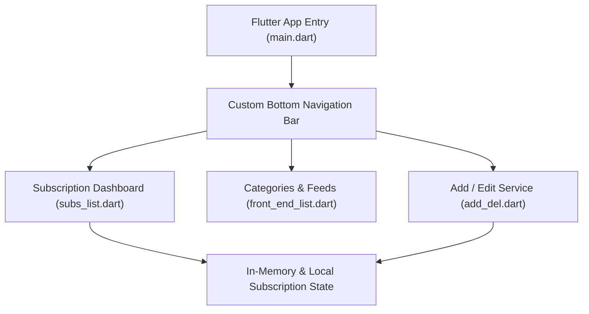

# 👁️ SubsEye — Smart Subscription & Expense Tracker

[](https://flutter.dev/)
[](https://dart.dev/)
[](https://developer.android.com/)
[](LICENSE)

**SubsEye** is a sleek, cross-platform mobile application developed with **Flutter** and **Dart** to help users organize, monitor, and manage their recurring digital subscriptions, track billing schedules, and receive timely renewal alerts to avoid unwanted charges.

---

## 📱 App Previews

<div align="center">
  
  &nbsp;&nbsp;
  
  &nbsp;&nbsp;
  
</div>

---

## 🌟 Key Features

- 📋 **Unified Subscription Hub:** Maintain active streaming, cloud, software, and gaming subscriptions (Netflix, Prime, Spotify, etc.) in a single dashboard.
- ⏰ **Renewal Alerts & Deadlines:** Visual indicators showing exact renewal timelines, cycle frequencies, and payment cutoffs.
- 💳 **Billing & Cost Breakdown:** Track total monthly and annual recurring expenditures to curb subscription fatigue.
- 🎨 **Adaptive Material UI:** Tailored interface with responsive widgets, card layouts, and custom bottom navigation.
- ➕ **Easy CRUD Workflow:** Seamlessly add new services, adjust pricing tiers, or delete expired subscriptions.

---

## 🛠️ App Architecture



---

## 📂 Repository Structure

```plaintext
SubsEye/
├── subseye/
│   ├── lib/
│   │   ├── main.dart             # Application initialization & theme configuration
│   │   ├── nav_bar.dart          # Custom bottom navigation bar widget
│   │   ├── subs_list.dart        # Main subscription feed and status badges
│   │   ├── front_end_list.dart   # Interactive service catalog
│   │   └── add_del.dart          # Add, update, and remove subscription logic
│   ├── android/                  # Native Android configuration & manifest
│   ├── ios/                      # Native iOS configuration
│   ├── pubspec.yaml              # Dependencies and asset declarations
│   └── analysis_options.yaml     # Dart lint rules
├── LICENSE                       # Project license
└── README.md                     # Application documentation & screenshots
```

---

## ⚡ Quickstart & Setup

### Prerequisites
- [Flutter SDK](https://docs.flutter.dev/get-started/install) (version 3.0 or higher)
- [Android Studio](https://developer.android.com/studio) or VS Code with Flutter extension
- An active Android Emulator or physical device connected via USB debugging

### Running the App

```bash
# 1. Clone the repository
git clone https://github.com/SLAYWITHME2005/SubsEye.git
cd SubsEye/subseye

# 2. Get Flutter packages
flutter pub get

# 3. Launch application on connected device
flutter run
```

---

## 👩‍💻 Contributors
- **Gayathri Rajeev** ([@SLAYWITHME2005](https://github.com/SLAYWITHME2005))
- Developed collaboratively with [@krishnakr05](https://github.com/krishnakr05)
